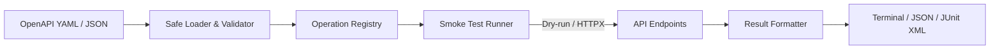

# OpenAPI Smoke

Automated OpenAPI specification validator and smoke-testing CLI for CI/CD pipelines.

[](https://github.com/AliSaleh07/openapi-smoke/actions/workflows/ci.yml)

## Core Capabilities

- **Secure Deserialization**: Employs `yaml.safe_load` exclusively to prevent arbitrary object instantiation during spec parsing.
- **Spec Compliance**: Validates OpenAPI 3.0, 3.1, and Swagger 2.0 documents for undeclared path parameters, missing schemas, and unhandled status codes.
- **Dry-Run Mode**: Inspects endpoint routing and method coverage offline without transmitting live network traffic.
- **Native CI Reporting**: Generates standard JUnit XML test reports compatible with GitHub Actions and CI test dashboards.



## Quickstart

```bash
python -m venv .venv
source .venv/bin/activate
pip install -r requirements.txt
pip install -e .
```

## Usage

```bash
# Validate specification syntax
openapi-smoke validate api_spec.yaml

# Dry-run smoke test (offline check)
openapi-smoke test api_spec.yaml --dry-run

# Live smoke test with custom headers
openapi-smoke test api_spec.yaml \
  --base-url https://api.example.com \
  --header "Authorization: Bearer <TOKEN>" \
  --strict

# Export JUnit XML test report for CI
openapi-smoke test api_spec.yaml --dry-run --format junit -o results.xml
```

## Running Tests

```bash
pytest -v tests/
```
---

## Safe Testing & Authorized Use Disclaimer
*OpenAPI Smoke is developed for automated API testing and CI/CD validation. Live smoke tests must only be executed against API endpoints you own or have explicit written permission to test. Unauthorized automated testing against third-party endpoints is strictly prohibited.*
